# Networkwalks Week 2: Footprinting, Reconnaissance & Network Scanning

*Hands-on website footprinting, DNS enumeration, network scanning and topology mapping for the Networkwalks Week 2 lab.*

[Overview](#overview) | [What I did](#what-i-did) | [Results](#results) | [Key findings](#key-findings) | [Commands](#command-reference) | [Screenshots](#screenshots) | [What I learned](#what-i-learned) | [Author](#author)

> [!IMPORTANT]
> **Authorised testing only.** The website was tested with written permission from the institute, and the network scan was done only on my own network. Nothing was exploited, no passwords were guessed and nothing was damaged.

## Overview

| | |
|---|---|
| **Intern** | Areeha Qamar |
| **Program / Batch** | B084- Networkwalks |
| **Date** | 22 November 2026 |
| **Modules** | PM1 (Footprinting & Reconnaissance), PM5 (Network Scanning with Zenmap), PM6 (Report) |
| **Phases covered** | Phase 1: Reconnaissance & Footprinting. Phase 2: Scanning & Network Discovery |
| **Targets** | networkwalks.com and my own local network |
| **Permission** | Yes, written permission from Networkwalks |
| **Environment** | Kali Linux 2026.3  and Windows 11 with Zenmap 7.993  |

## What I did

**PM1: Footprinting & Reconnaissance (Kali Linux).** I used six tools to collect public information about the authorised website: who registered it, what it is built with, its IP address, its HTTP headers, whether a firewall protects it and how its DNS is set up.

**PM5: Network Scanning (Zenmap on Windows).** I installed Zenmap from the official website, found my IP address and subnet with `ipconfig`, ran a ping scan to find live hosts, recorded their IP and MAC addresses and saved the network topology as a PDF.

**PM6: Report.** I wrote a full penetration testing report with findings, risk levels and recommendations.

## Results

| Task | Result |
|---|---|
| whois | Registrar: GoDaddy.com, Date: 2019. Owner name hidden, organisation details visible |
| whatweb | Apache, WordPress[7.1.5]  |
| nslookup | Website IP address: 192.232.216.135 |
| curl -I | 2 out of 6  |
| wafw00f | Yes, ModSecurity (SpiderLabs) |
| dnsrecon | 2 name servers, 1 mail server, SPF present, zone transfer not allowed |
| Zenmap | 4 live hosts found on 192.168.18.0/24 , all recognised |

## Key findings

These are observations, not proven weaknesses.

| Finding | Risk |
|---|---|
| Website software details are visible | Medium |
| Some security headers are missing | Low |
| Firewall (WAF) status | Low |
| DNS records and website IP are public | Medium |
| Domain registration details are public | Low |
| Devices on my local network | Low |

## Recommendations

- Keep website software, plugins and servers updated.
- Hide version details and add the missing security headers.
- Keep the firewall turned on and updated.
- Use WHOIS privacy and hide the DNS server version.
- Know every device on your network and secure the router.

## Command reference

| Command | Purpose |
|---|---|
| `whois networkwalks.com` | Shows who registered the domain, the dates and the name servers |
| `whatweb networkwalks.com` | Identifies the web server, platform and technologies of the website |
| `nslookup networkwalks.com` | Finds the IP address of the website using DNS |
| `curl -I https://networkwalks.com` | Shows the HTTP response headers only |
| `wafw00f networkwalks.com` | Detects whether a Web Application Firewall protects the site |
| `dnsrecon -d networkwalks.com` | Lists DNS records: name servers, mail servers, TXT and more |
| `ipconfig /all` | Shows my IP address, subnet mask and gateway on Windows |
| `nmap -sn 192.168.18.0/24` | Ping scan that finds live hosts (this is Zenmap's "Ping scan" profile) |

## Screenshots

### PM1: Footprinting & Reconnaissance

**1. whois**
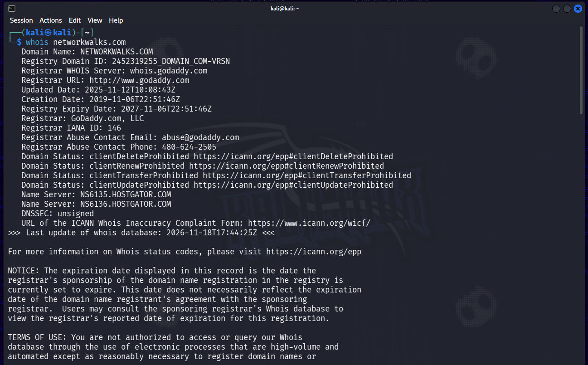
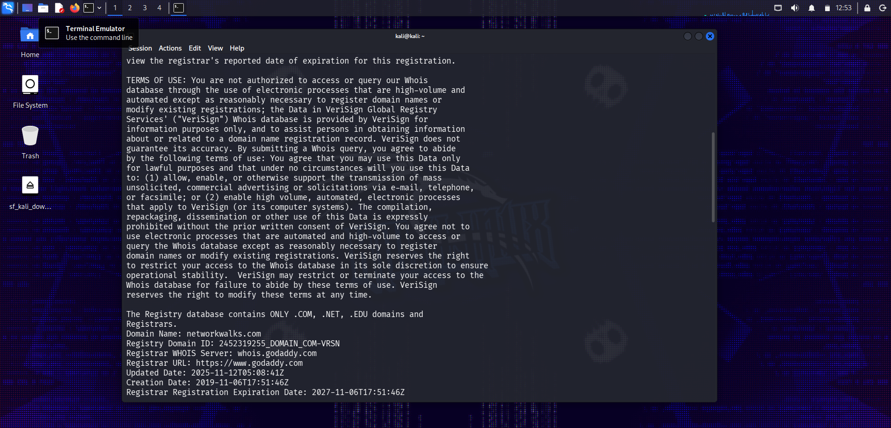
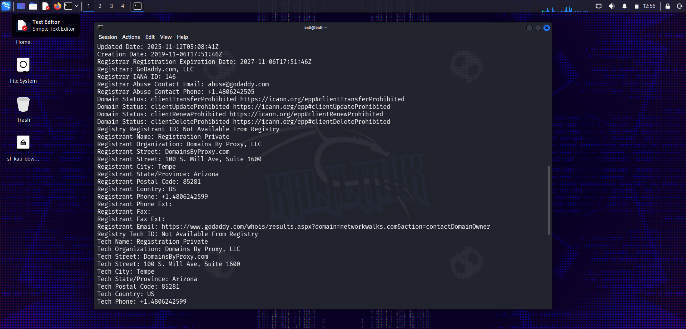
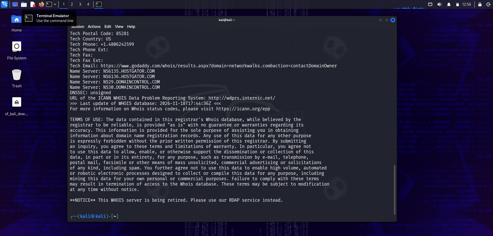

**2. whatweb**
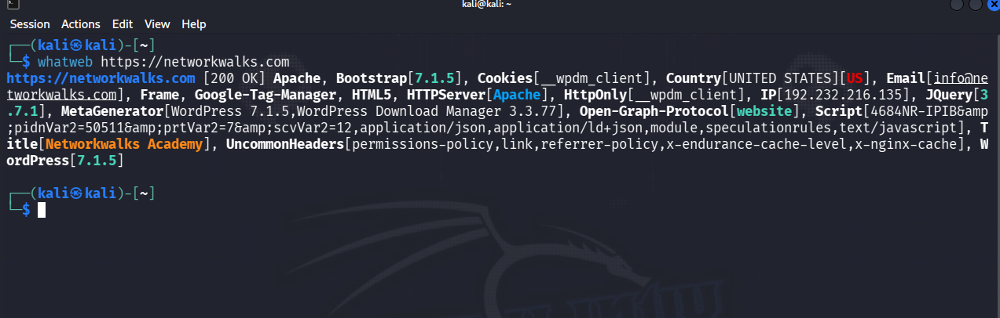

**3. nslookup**
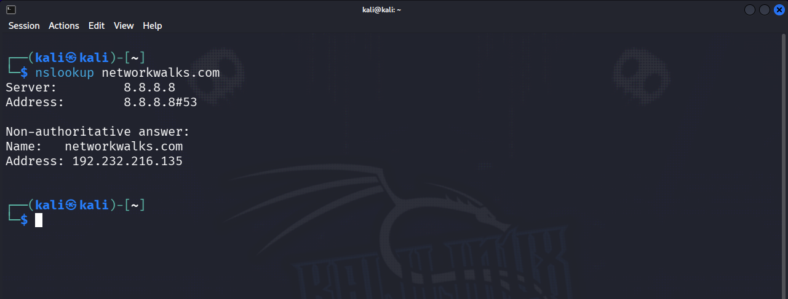

**4. curl -I**
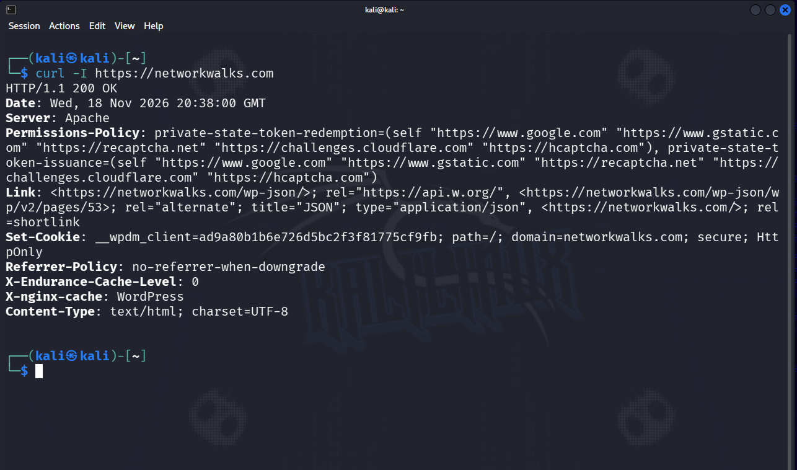

**5. wafw00f**
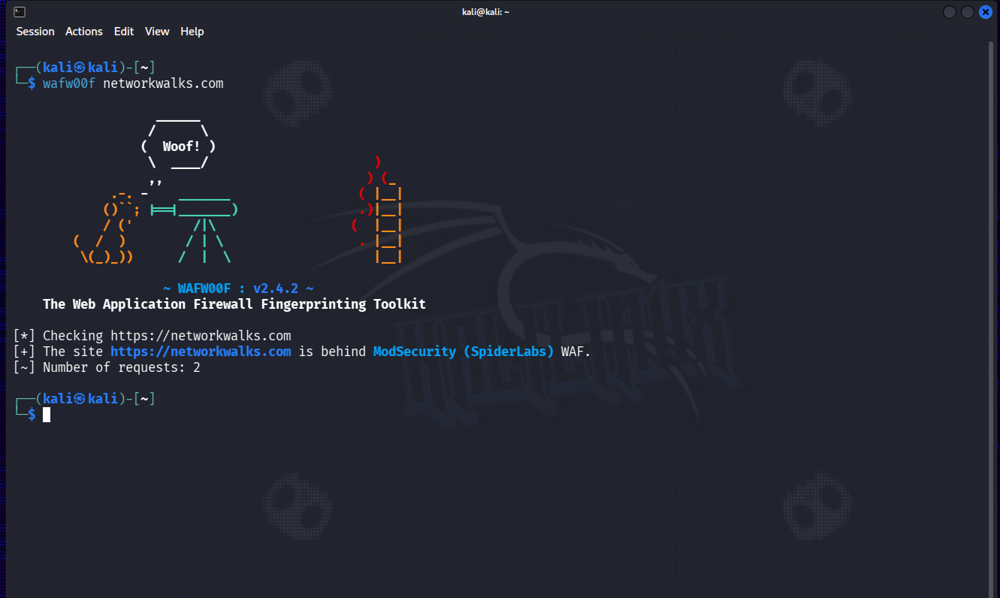

**6. dnsrecon**
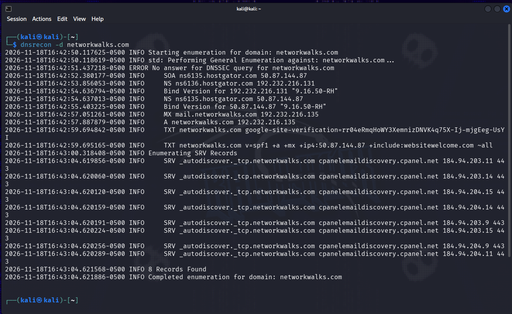

### PM5: Network Scanning with Zenmap

**7. Zenmap installed**
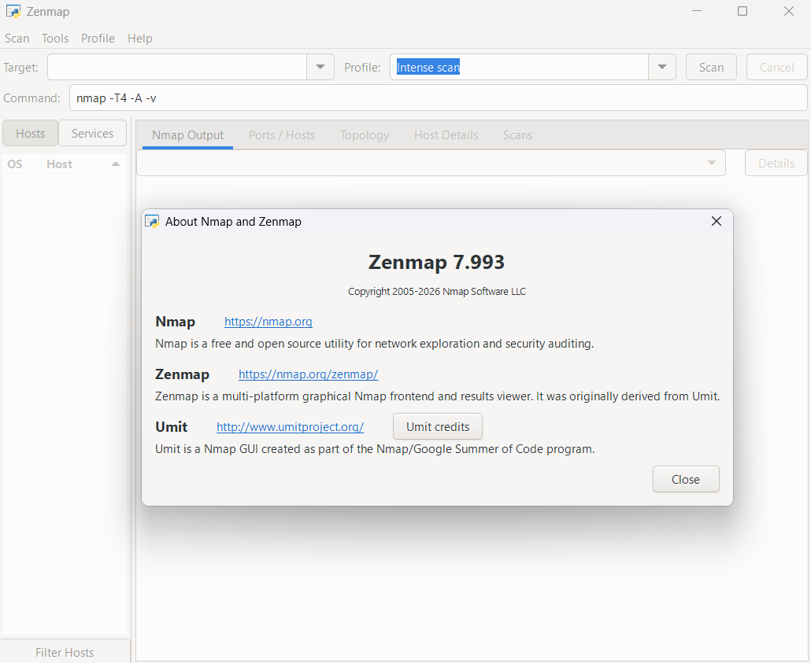

**8. ipconfig: IP address and subnet**
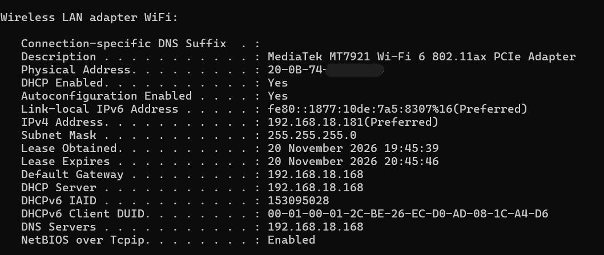

**9. Ping scan: live hosts**
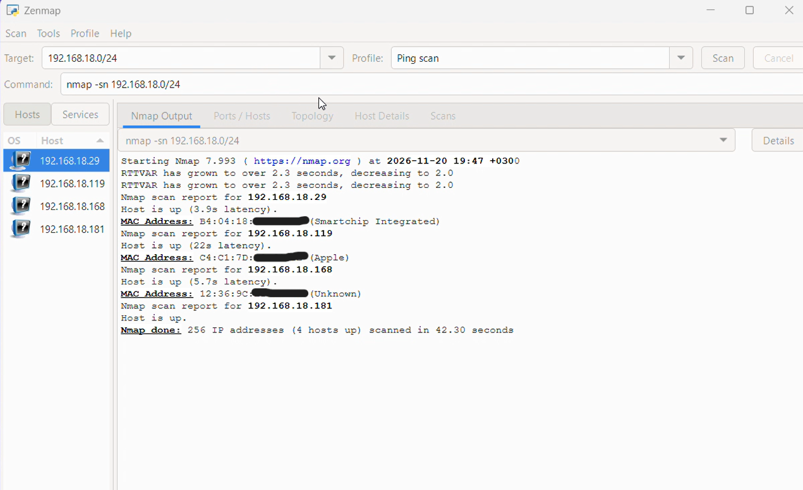

**10. MAC addresses (partly hidden)**
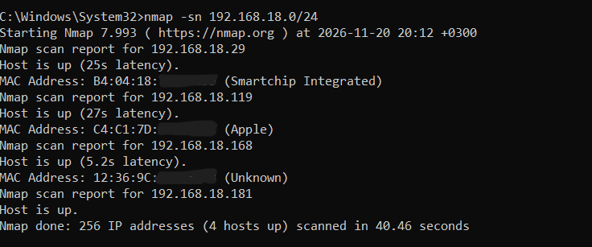

**11. Network topology**
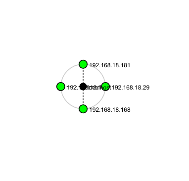

## Evidence collected

- Screenshots of every task (folder `screenshots/`)
- Network topology exported from Zenmap: [`topology.pdf`](topology.pdf)
- Full penetration testing report: [`Pentest_Report.pdf`](Pentest_Report.pdf)

## What I learned

- Each tool answers a different question: who owns the website, what it is built with, where it is, what it tells browsers, whether a firewall protects it and how its DNS is set up.
- Zenmap can quickly show every live device on a network with its IP and MAC address.
- Something I can see is not the same as a proven weakness.
- Testing must always stay inside written permission.

## Privacy note

MAC addresses and private details of my own devices are partly hidden.

## Disclaimer

For education and research only. Do not use these methods on any system you do not own or have permission to test. Unauthorised access to computer systems is a crime in most countries.

## Author

**Areeha Qamar**, B084-Networkwalks

- LinkedIn: www.linkedin.com/in/areeha-qamar422
- Full report: [Pentest_Report.pdf](Pentest_Report.pdf)
